 

 

## ◗ About

I'm a **Software Engineer at NQAAE** in Tashkent, focused on Python backends —
Django, FastAPI, PostgreSQL and Docker — and on AI integrations. I build the
parts of a product people rarely see but always feel: APIs, admin panels,
Telegram bots, and AI assistants that take real work off people's hands.

I care about software that ships: clear data models, predictable deploys, and
code the next developer can read without calling me.

🎓 Tashkent State Transport University · 💼 Open to new opportunities — on-site, hybrid or remote

 

## ◗ What I work on

<table>
<tr>
<td width="50%" valign="top">

### 🦷 Dental platform

Clinic management — patients, appointments and records.
Python backend with a TypeScript front end.

</td>
<td width="50%" valign="top">

### 🤖 Telegram bots

CRM, ordering and finance bots that turn a chat into a working tool for a
small business.

</td>
</tr>
<tr>
<td width="50%" valign="top">

### 🏦 Asset management

A web app for tracking organisational assets, built with Astro.

</td>
<td width="50%" valign="top">

### 🧠 AI products

Voice assistants and AI-powered tools for real estate, furniture and
everyday business work.

</td>
</tr>
</table>

 

## ◗ Tools I reach for

  

 

## ◗ GitHub stats

 

## ◗ Contribution graph

 

## ◗ Get in touch

  

<i>Have a project that needs a backend, a bot or an AI assistant? Write to me on Telegram.</i>

